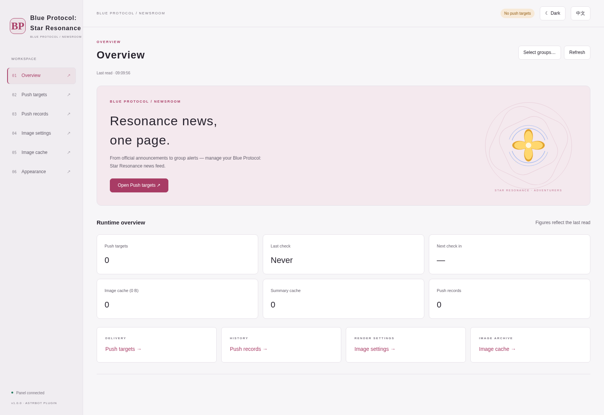
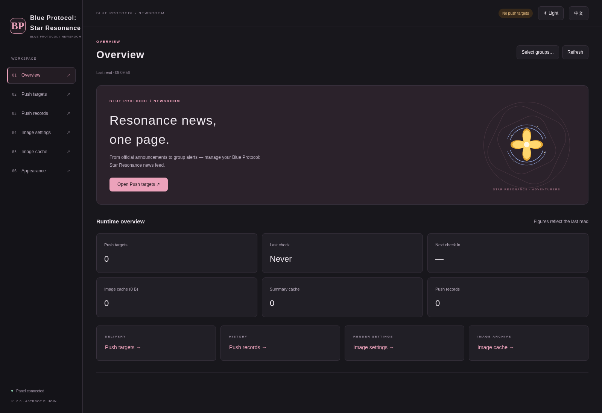

# astrbot_plugin_blue_protocol

**Blue Protocol: Star Resonance** (《蓝色协议：星痕共鸣》) official announcement bot for AstrBot.

Announcement list with paging and categories, latest announcement with a summary and a phone-sized long image, per-group deduplication, scheduled auto-push, plus a web panel for managing push targets by group name.

Data comes from the Tencent game announcement API behind the official site (`apps.game.qq.com/wmp/v3.1/`) — both the list and the article body are served straight from the API, no HTML scraping.

---

# English

## Announcement long image

The announcement body is returned as HTML by the API, so the plugin renders it through its own template and takes a full-page screenshot at a 390×844 phone viewport — the content is complete, and it does not depend on the official site's JavaScript-rendered SPA.


## Web panel preview

Toggle **light / dark** in the top right, or pick "Follow AstrBot" under *Appearance*; light is the default when the host theme is unavailable. The theme and compact-layout preference are stored in the current browser, the layout adapts on narrow screens, and wide tables scroll horizontally.

- Navigation: Overview, Push targets, Push records, Image settings, Image cache, Appearance.
- Stat cards keep their label/value rows aligned, as do the checkboxes and filter toolbar.
- Plain local HTML / CSS / JavaScript — no build step and no external icon fonts; it talks to the backend through the AstrBot Plugin Pages bridge.

**Light**



<details>
<summary>Dark</summary>



</details>

> Preview screenshots come from a local browser test with mock data and do not represent a live bot.

## Commands

Commands are English and start with `bp`. The aliases `blue protocol` and `blueprotocol` also work, so the prefix never collides with another plugin's bare-word commands.

| Command | Description |
|---|---|
| `bp list [category] [page]` | Announcement list. Category: `all` / `notice` / `news` / `event` (default `all`). Page defaults to 1; rows per page come from `list_page_size` |
| `bp latest` | Newest announcement: category, title, date, link, summary — plus the long image |
| `bp latest dedup` | Same, but only replies when there is something new (per-group dedup) |
| `bp push on\|off\|status\|test` | Auto-push for this group, checked every **5 minutes** (`on` / `off` / `test` need admin) |
| `bp reset` | Clear this group's push record (admin) |
| `bp help` | Command usage |

Examples:

```
bp list
bp list notice 2
blueprotocol list news
bp push on
bp latest
```

Category aliases: `notice` = `announcement` / `announcements` / `ann`, `event` = `events` / `activity`, `all` = `latest`. Matching is case-insensitive.

## Internationalisation

The plugin ships two languages, English and 中文 (Simplified Chinese).

| Where | How the language is chosen |
|---|---|
| **Web panel UI** | Auto-detected from the **browser time zone**: China mainland / Hong Kong / Macau / Taiwan → 中文, everywhere else → English. The top-right button (and the *Language* select under *Appearance*) switches it manually; your choice is remembered in this browser and always wins over auto-detection. |
| **Plugin config page** (AstrBot WebUI) | Follows AstrBot's own interface language. Both `zh-CN` and `en-US` are provided. |
| **Plugin marketplace entry** | Follows AstrBot's own interface language. |

The announcement titles and bodies themselves stay in the game's original Chinese — only the plugin's own interface is translated.

## Configuration (WebUI plugin config page)

| Key | Default | Description |
|---|---|---|
| `news_groups` | `[]` | Groups that receive scheduled pushes (a **group id** or `unified_msg_origin`, multiple allowed). You can also send `bp push on` in a group, or **tick groups by name in the plugin panel** |
| `list_page_size` | `10` | Announcements per page in `bp list` (1-30) |
| `shot_enabled` | `true` | Render announcements as a phone-sized long image; when off it falls back to the dark card image |
| `shot_max_height` | `5000` | Maximum long-image height in CSS pixels (0 = no limit). Very long announcements are cut here and the text message points to the link |
| `shot_quality` | `88` | Long-image JPEG quality. Images above 2.5 MB are downscaled automatically |

## Web panel (the recommended way to manage push targets)

AstrBot WebUI → Plugins → Blue Protocol: Star Resonance → open the panel (needs AstrBot ≥ 4.24.1):

- **Push targets** — tick groups by **name** (the dropdown shows `group name (group id)`), so you never have to remember an id. `Select groups…` searches by name or id, and `Refresh group list` pulls every group the bot is in at once.
- **Check & push now** — run a round immediately instead of waiting for the 5-minute poll. Per-group `Test push` can force a re-send to verify delivery.
- **Push records** — the last announcement pushed to each group, with per-group or global reset.
- **Image cache** — thumbnails of the rendered long images plus their disk usage, with a one-click clear. The image settings (on/off, max height, quality) are editable here too.
- The selection in `Select groups…` only applies after you press **Save push targets** — it writes back the same `news_groups` config as `bp push on` does in a group.

> When you type a **bare group id**, the plugin expands it to `platform instance id` + `GroupMessage` + id (e.g. `napcat:GroupMessage:123`). Use the *instance id*, not the adapter type name: AstrBot's `send_message` matches on the instance id, so `aiocqhttp:GroupMessage:123` is silently dropped.

Group names are collected as messages arrive (platform events that carry a name are used directly); the first time a group is seen the plugin asks the platform for `get_group_info` in the background, and `Refresh group list` calls `get_group_list` once to fill in every group — so **groups that have never spoken are selectable too**. The cache lives in `groups.json`; a group with no cached name shows as `群 <id>`, which does not affect delivery.

## Data files

All under `data/plugin_data/astrbot_plugin_blue_protocol/`:

- `push_record.json` — per-group push dedup records
- `summary_cache.json` — summary cache (24 h)
- `news_shots/` — rendered long images, keyed by announcement id (newest 20 kept, plus a 7-day fallback)
- `groups.json` — group name cache for the panel (safe to delete; the panel just falls back to group ids)

## Implementation notes

- **Endpoints**
  - List: `https://apps.game.qq.com/wmp/v3.1/?p0=440&p1=searchNewsKeywordsList&page=<page>&pagesize=<size>&order=sIdxTime&r0=script&r1=NewsObj5014741213624121&type=iTag&id=<category id>&source=web_pc`
  - Detail: `https://apps.game.qq.com/wmp/v3.1/public/searchNews.php?p0=440&source=web_pc&id=<news id>`
  - Human-readable article: `https://gm.qq.com/web202503/news-detail.html?newsid=<news id>`
- **JSONP, not JSON** — both endpoints answer with `var XXX = {...};`. The plugin strips the wrapper with a brace-matching scan that is aware of string escapes; a regex breaks on the escaped braces inside `sCoverMap`.
- **The payload lives in `msg`** — the `data` field is an empty string and `status: 0` means success.
- **Category ids are hard-coded** in the official `news-list.html` (`newsTagList`): `136243=all`, `136246=notice`, `136245=news`, `136247=event`. The list endpoint filters with `type=iTag&id=<id>`; `136243` is the aggregated feed, and each row's own `sTagIds` carries the real category (sometimes several, comma separated).
- **Cover images are protocol-relative** (`//static.gametalk.qq.com/...`) — `https:` is prepended before use.
- **Article body** (`msg.sContent`) is clean HTML (`<p>` / `<br/>` plus HTML entities) with no images, which makes it ideal for rendering our own long image.
- The body usually opens with "冒险者，您好！" — the summary skips that greeting line.
- Admin commands (`on` / `off` / `test` / `reset`) require AstrBot's `admins_id` (a WebUI setting, not the QQ group admin list).

## Development

```bash
python tests/test_api.py              # data layer: JSONP, field mapping, summaries
python tests/test_groups.py            # group-name cache logic
python tests/test_panel.py             # panel backend routes (astrbot is stubbed)
python tests/test_blueprotocol_main.py # main.py wiring and push flow
python tests/test_metadata.py          # packaging contract (metadata / conf schema / i18n)
python tests/test_panel_layout_ui.py   # panel UI in a real browser (needs Playwright)
python tools/make_logo.py              # regenerate logo.png / the panel icon
```

---

# 中文

## 公告长图

公告正文由接口直接给 HTML，插件套进自带模板后用 Playwright 以 390×844 手机视口整页截图 —— 内容完整、不依赖官网那个 JS 渲染的 SPA。


## Web 面板

右上角可一键切换 **浅色 / 深色**，也可在「界面外观」中选择跟随 AstrBot；未提供宿主主题时默认浅色。主题及紧凑布局偏好保存在当前浏览器，手机窄屏下自动调整布局，宽表格可横向滚动。

- 页面导航：总览、推送群、推送记录、公告图设置、截图缓存、界面外观。
- 统一统计卡片标签与数值排版、复选框及筛选工具栏对齐。
- 使用本地 HTML / CSS / JavaScript，无需前端构建或外部图标字体；通过 AstrBot Plugin Pages 桥接访问后端。

## 指令

指令为英文，以 `bp` 开头；`blue protocol`、`blueprotocol` 同样可用，避免与其它插件的裸词指令冲突。

| 指令 | 说明 |
|---|---|
| `bp list [分类] [页码]` | 公告列表。分类可选 `all` / `notice` / `news` / `event`（默认 `all`），页码从 1 开始，每页条数由 `list_page_size` 控制 |
| `bp latest` | 最新公告：分类/标题/日期/链接/摘要 + 手机长图 |
| `bp latest dedup` | 同上，但只有出新公告才回复（按群去重） |
| `bp push on\|off\|status\|test` | 本群自动推送，每 **5 分钟** 检查一次（`on` / `off` / `test` 需管理员） |
| `bp reset` | 清空本群推送记录（需管理员） |
| `bp help` | 查看指令用法 |

分类别名：`notice` = `announcement` / `announcements` / `ann`，`event` = `events` / `activity`，`all` = `latest`，不区分大小写。

## 国际化

插件内置 **English** 与 **中文（简体）** 两套语言。

| 位置 | 语言如何决定 |
|---|---|
| **Web 面板界面** | 按**浏览器时区**自动判断：中国大陆 / 港澳台 → 中文，其他地区 → English。右上角的按钮（以及「界面外观」里的 *Language* 下拉）可手动切换，选择会记在这个浏览器里，且优先级高于自动判断。 |
| **插件配置页**（AstrBot WebUI） | 跟随 AstrBot 自身的界面语言，提供 `zh-CN` 与 `en-US` 两套。 |
| **插件市场条目** | 跟随 AstrBot 自身的界面语言。 |

公告标题与正文保持游戏原样的中文，只翻译插件自己的界面。

## 配置项

| 配置项 | 默认 | 说明 |
|---|---|---|
| `news_groups` | `[]` | 定时推送的群（填**群号**或 unified_msg_origin，可多个）。也可以在群里发 `bp push on` 自动登记本群，**或直接在插件面板里按群名勾选** |
| `list_page_size` | `10` | 公告列表每页条数（1-30） |
| `shot_enabled` | `true` | 公告图用手机整页长图；关掉则回到深色卡片图 |
| `shot_max_height` | `5000` | 长图最大高度（CSS 像素，0 = 不截断）。超长公告截取前面部分，文字消息里提示看链接 |
| `shot_quality` | `88` | 长图 JPEG 质量。成图超过 2.5MB 会自动继续降质/缩放 |

## Web 面板用法

AstrBot WebUI → 插件 → Blue Protocol: Star Resonance → 打开面板（需要 AstrBot ≥ 4.24.1）：

- **推送群**：按**群名**勾选要推送的群，不用记群号；`选择群…` 里可以搜索群名或群号，还能「刷新群列表」把机器人所在的全部群一次拉出来。
- **立刻检查并推送**：不用等 5 分钟轮询周期；单群「测试推送」还能强制重发，用来验证群里到底收不收得到。
- **推送记录**：每个群上次推的公告标题，支持单群/全部重置。
- **截图缓存**：公告长图缩略图 + 占用空间，一键清空；长图参数（开关/最大高度/质量）也能在面板里改。

> 群名单里填**裸群号**时，插件会把它补成「平台**实例 id** + GroupMessage + 群号」（例如 `napcat:GroupMessage:123`）。要填实例 id 而不是适配器类型名：AstrBot 的 `send_message` 按实例 id 匹配平台，写 `aiocqhttp:GroupMessage:123` 这种发不出去。

群名从哪来：群里来消息时顺手记（平台事件自带群名就直接用），首次见到某个群会后台问一次 `get_group_info`，点「刷新群列表」则调 `get_group_list` 一次补齐所有群 —— 所以**群里没说过话的群也能按群名选到**。名字缓存落在 `groups.json`，查不到名字就显示「群 群号」，不影响推送。

## 数据存储

- 推送去重记录：`data/plugin_data/astrbot_plugin_blue_protocol/push_record.json`
- 摘要缓存（24h）：同目录 `summary_cache.json`
- 公告长图缓存：同目录 `news_shots/`（按公告 id 哈希命名，保留最近 20 张 + 7 天兜底）
- 群名缓存（面板显示用）：同目录 `groups.json`（可删，删了只是面板里重新显示群号）

## License

MIT
