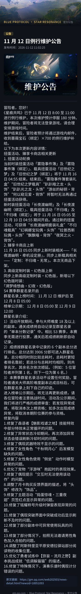
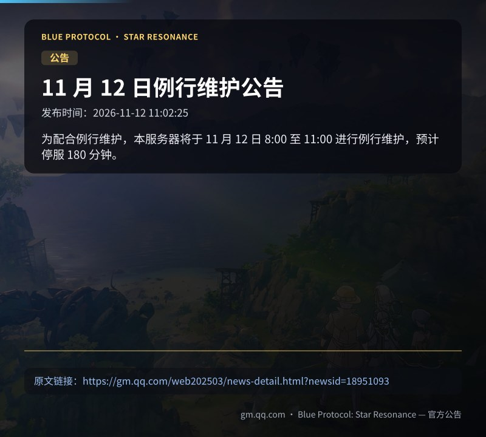
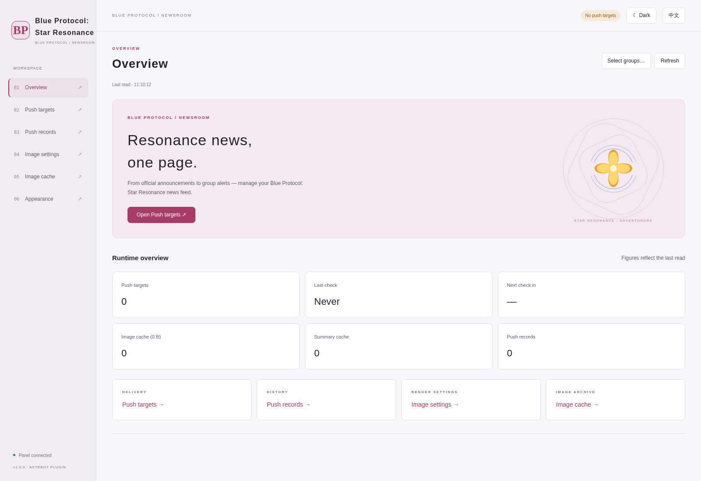
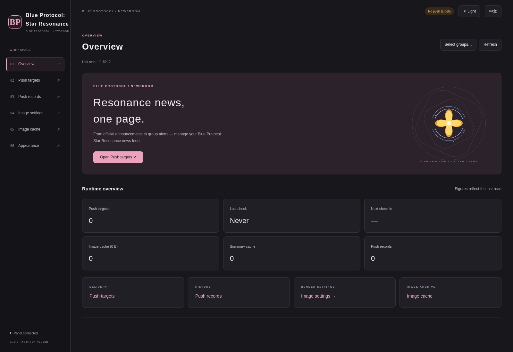

# astrbot_plugin_blue_protocol

**Blue Protocol: Star Resonance** (《蓝色协议：星痕共鸣》) official announcement bot for AstrBot.
《蓝色协议：星痕共鸣》官方公告推送插件 —— 公告列表、最新公告长图、按群去重、定时推送，带 Web 面板。

Announcement list with paging and categories, latest announcement with a summary and a phone-sized long image, per-group deduplication, scheduled auto-push, plus a web panel for managing push targets by group name.

公告列表支持分页与分类；最新公告带正文摘要与手机长图；按群去重；每 5 分钟检查一次自动推送；Web 面板可按群名管理推送群、手动推送、查看长图缓存。

Data comes from the Tencent game announcement API behind the official site (`apps.game.qq.com/wmp/v3.1/`) — both the list and the article body are served straight from the API, no HTML scraping.

数据来自官网背后的腾讯游戏公告接口（`apps.game.qq.com/wmp/v3.1/`），列表与正文都直接取自接口，不抓取 HTML。

---

# English

## Typesetting with Typst

Announcement images are typeset **locally with [Typst](https://typst.app/)** — no browser component needed:

- The long image and the card are compiled by the `typst` Python package inside an **isolated subprocess** with a timeout and a hard kill, so a weird announcement can never wedge the plugin.
- The announcement HTML is turned into a tiny JSON contract (`runs` / `br`); the templates live in `templates/typst/*.typ` and are compiled against `data.json`.
- The CJK font is resolved from the plugin data directory first, then from system fonts, and finally downloaded once on first use. The resolved family name is passed to the template, so no “unknown font family” warnings.
- Typst is the **primary** renderer. If it is missing or fails, the plugin falls back to the Playwright long image, then to the Typst card, and finally to the `html_render` card — images keep working either way.

## Announcement long image

The announcement body is returned as HTML by the API, so the plugin renders it through its own template and takes a full-page screenshot at a 390×844 phone viewport — the content is complete, and it does not depend on the official site's JavaScript-rendered SPA.



## Announcement card

When the long image cannot be rendered (Playwright unavailable), the plugin falls back to a share card built on the **official KV banner** (`game.gtimg.cn/images/bpm/web202412/kv.jpg`):

- The banner fills the whole card **PPT style** — full bleed, `background-size: cover`.
- A diagonal gradient scrim runs from **0 % opacity at the top-left to 100 % at the bottom-right**, and the banner itself is dimmed (`brightness(.58)`), so the title, summary and link stay readable.
- The top-left corner reuses the official `.news-container::before / ::after` technique (`news-detail-bg.jpg`) to draw the accent divider line, masked so it fades out towards the right.



## Web panel preview

Toggle **light / dark** in the top right, or pick "Follow AstrBot" under *Appearance*; light is the default when the host theme is unavailable. The theme and compact-layout preference are stored in the current browser, the layout adapts on narrow screens, and wide tables scroll horizontally.

- Navigation: Overview, Push targets, Push records, Image settings, Image cache, Appearance.
- Stat cards keep their label/value rows aligned, as do the checkboxes and filter toolbar.
- Plain local HTML / CSS / JavaScript — no build step and no external icon fonts; it talks to the backend through the AstrBot Plugin Pages bridge.

**Light**



<details>
<summary>Dark</summary>



</details>

> Preview screenshots come from a local browser test with mock data and do not represent a live bot.

## Commands

Commands are English and start with `bp`. The aliases `blue protocol` and `blueprotocol` also work, so the prefix never collides with another plugin's bare-word commands.

| Command | Description |
|---|---|
| `bp list [category] [page]` | Announcement list. Category: `all` / `notice` / `news` / `event` (default `all`). Page defaults to 1; rows per page come from `list_page_size` |
| `bp latest` | Newest announcement: category, title, date, link, summary — plus the long image |
| `bp latest dedup` | Same, but only replies when there is something new (per-group dedup) |
| `bp push on\|off\|status\|test` | Auto-push for this group, checked every **5 minutes** (`on` / `off` / `test` need admin) |
| `bp reset` | Clear this group's push record (admin) |
| `bp help` | Command usage |

Examples:

```
bp list
bp list notice 2
blueprotocol list news
bp push on
bp latest
```

Category aliases: `notice` = `announcement` / `announcements` / `ann`, `event` = `events` / `activity`, `all` = `latest`. Matching is case-insensitive.

## Internationalisation

The plugin ships two languages, English and 中文 (Simplified Chinese).

| Where | How the language is chosen |
|---|---|
| **Web panel UI** | Auto-detected from the **browser time zone**: China mainland / Hong Kong / Macau / Taiwan → 中文, everywhere else → English. The top-right button (and the *Language* select under *Appearance*) switches it manually; your choice is remembered in this browser and always wins over auto-detection. |
| **Plugin config page** (AstrBot WebUI) | Follows AstrBot's own interface language. Both `zh-CN` and `en-US` are provided. |
| **Plugin marketplace entry** | Follows AstrBot's own interface language. |

The announcement titles and bodies themselves stay in the game's original Chinese — only the plugin's own interface is translated.

## Configuration (WebUI plugin config page)

| Key | Default | Description |
|---|---|---|
| `news_groups` | `[]` | Groups that receive scheduled pushes (a **group id** or `unified_msg_origin`, multiple allowed). You can also send `bp push on` in a group, or **tick groups by name in the plugin panel** |
| `list_page_size` | `10` | Announcements per page in `bp list` (1-30) |
| `shot_enabled` | `true` | Render announcements as a phone-sized long image; when off it falls back to the dark card image |
| `shot_max_height` | `5000` | Maximum long-image height in CSS pixels (0 = no limit). Very long announcements are cut here and the text message points to the link |
| `shot_quality` | `88` | Long-image JPEG quality. Images above 2.5 MB are downscaled automatically |
| `typst_enabled` | `true` | Typeset announcement images with the local Typst compiler (primary renderer); when off the plugin uses browser screenshots |
| `typst_ppi` | `144` | Typst export density in PPI (72-300). Higher means sharper and larger |
| `typst_timeout` | `60` | Time limit for one Typst run in seconds (5-600). On timeout the compile process is killed |
| `typst_font_url` | `""` | Optional CJK font download URL, used when the system has no Chinese font |

## Web panel (the recommended way to manage push targets)

AstrBot WebUI → Plugins → Blue Protocol: Star Resonance → open the panel (needs AstrBot ≥ 4.24.1):

- **Push targets** — tick groups by **name** (the dropdown shows `group name (group id)`), so you never have to remember an id. `Select groups…` searches by name or id, and `Refresh group list` pulls every group the bot is in at once.
- **Check & push now** — run a round immediately instead of waiting for the 5-minute poll. Per-group `Test push` can force a re-send to verify delivery.
- **Push records** — the last announcement pushed to each group, with per-group or global reset.
- **Image cache** — thumbnails of the rendered long images plus their disk usage, with a one-click clear. The image settings (on/off, max height, quality) are editable here too.
- The selection in `Select groups…` only applies after you press **Save push targets** — it writes back the same `news_groups` config as `bp push on` does in a group.

> When you type a **bare group id**, the plugin expands it to `platform instance id` + `GroupMessage` + id (e.g. `napcat:GroupMessage:123`). Use the *instance id*, not the adapter type name: AstrBot's `send_message` matches on the instance id, so `aiocqhttp:GroupMessage:123` is silently dropped.

Group names are collected as messages arrive (platform events that carry a name are used directly); the first time a group is seen the plugin asks the platform for `get_group_info` in the background, and `Refresh group list` calls `get_group_list` once to fill in every group — so **groups that have never spoken are selectable too**. The cache lives in `groups.json`; a group with no cached name shows as `群 <id>`, which does not affect delivery.

## Data files

All under `data/plugin_data/astrbot_plugin_blue_protocol/`:

- `push_record.json` — per-group push dedup records
- `summary_cache.json` — summary cache (24 h)
- `news_shots/` — rendered long images, keyed by announcement id (newest 20 kept, plus a 7-day fallback)
- `groups.json` — group name cache for the panel (safe to delete; the panel just falls back to group ids)

## Implementation notes

- **Endpoints**
  - List: `https://apps.game.qq.com/wmp/v3.1/?p0=440&p1=searchNewsKeywordsList&page=<page>&pagesize=<size>&order=sIdxTime&r0=script&r1=NewsObj5014741213624121&type=iTag&id=<category id>&source=web_pc`
  - Detail: `https://apps.game.qq.com/wmp/v3.1/public/searchNews.php?p0=440&source=web_pc&id=<news id>`
  - Human-readable article: `https://gm.qq.com/web202503/news-detail.html?newsid=<news id>`
- **JSONP, not JSON** — both endpoints answer with `var XXX = {...};`. The plugin strips the wrapper with a brace-matching scan that is aware of string escapes; a regex breaks on the escaped braces inside `sCoverMap`.
- **The payload lives in `msg`** — the `data` field is an empty string and `status: 0` means success.
- **Category ids are hard-coded** in the official `news-list.html` (`newsTagList`): `136243=all`, `136246=notice`, `136245=news`, `136247=event`. The list endpoint filters with `type=iTag&id=<id>`; `136243` is the aggregated feed, and each row's own `sTagIds` carries the real category (sometimes several, comma separated).
- **Cover images are protocol-relative** (`//static.gametalk.qq.com/...`) — `https:` is prepended before use.
- **Article body** (`msg.sContent`) is clean HTML (`<p>` / `<br/>` plus HTML entities) with no images, which makes it ideal for rendering our own long image.
- The body usually opens with "冒险者，您好！" — the summary skips that greeting line.
- Admin commands (`on` / `off` / `test` / `reset`) require AstrBot's `admins_id` (a WebUI setting, not the QQ group admin list).

## Development

```bash
python tests/test_api.py              # data layer: JSONP, field mapping, summaries
python tests/test_groups.py            # group-name cache logic
python tests/test_panel.py             # panel backend routes (astrbot is stubbed)
python tests/test_blueprotocol_main.py # main.py wiring and push flow
python tests/test_metadata.py          # packaging contract (metadata / conf schema / i18n)
python tests/test_panel_layout_ui.py   # panel UI in a real browser (needs Playwright)
python tests/test_typst_render.py      # local Typst typesetting (needs the typst package)
python tools/make_logo.py              # regenerate logo.png / the panel icon
```

---
