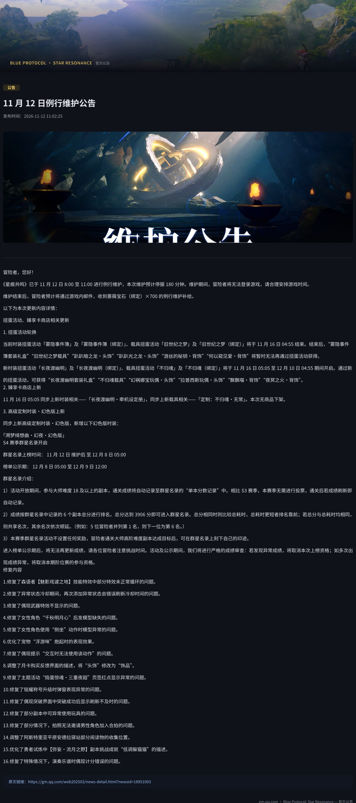
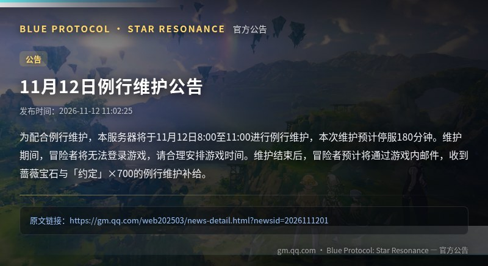

# astrbot_plugin_blue_protocol

**Blue Protocol: Star Resonance** (《蓝色协议：星痕共鸣》) official announcement bot for AstrBot.
《蓝色协议：星痕共鸣》官方公告推送插件 —— 公告列表、最新公告长图、按群去重、定时推送，带 Web 面板。

Announcement list with paging and categories, latest announcement with a summary and a browser-width long image, per-group deduplication, scheduled auto-push, plus a web panel for managing push targets by group name.

公告列表支持分页与分类；最新公告带正文摘要与浏览器宽度长图；按群去重；每 5 分钟检查一次自动推送；Web 面板可按群名管理推送群、手动推送、查看长图缓存。

Data comes from the Tencent game announcement API behind the official site (`apps.game.qq.com/wmp/v3.1/`) — both the list and the article body are served straight from the API, no HTML scraping.

数据来自官网背后的腾讯游戏公告接口（`apps.game.qq.com/wmp/v3.1/`），列表与正文都直接取自接口，不抓取 HTML。

---

# 中文

## 用 Typst 本地排版

公告图现在由 **[Typst](https://typst.app/) 在本地排版**，不再依赖浏览器组件：

- 长图和卡片都由 `typst` 这个 Python 包在**独立子进程**里编译，带超时和强制结束，异常公告不会把插件卡住。
- 正文 HTML 先转成一份很小的 JSON 契约（`runs` / `br`），模板放在 `templates/typst/*.typ`，编译时读 `data.json`。
- 中文字体按「插件数据目录 → 系统字体 → 首次使用时自动下载」的顺序解析；解析出的字体名会写进数据里传给模板，不会再出现“unknown font family”警告。
- Typst 是**首选**渲染方式；装不上或出错时会依次回退到浏览器长图 → Typst 卡片 → `html_render` 卡片，图片照样能出。

版式尺寸全部按 **CSS 像素**算，和浏览器一致：

| 项目 | 默认 | 配置项 |
|---|---|---|
| 画布宽度 | `1280` px（常见浏览器宽度） | `typst_long_width` |
| 正文栏宽度 | `1258` px | `typst_long_body_width` |
| 正文两侧边框 | `11` px | `typst_long_border` |
| 主题 | `dark`（可切 `light`） | `typst_long_theme` |
| 段落间距 | `14` px | `typst_para_spacing` |
| 行高 | `1.8` | `typst_line_height` |

Typst 与浏览器兜底共用同一份版式定义（`bpnews/layout.py`），两条路出来的图长得一样。

## 公告长图

公告正文由接口直接给 HTML，插件套进自带模板后整页排版 —— 内容完整、不依赖官网那个 JS 渲染的 SPA。画布默认是完整浏览器宽度，正文和网页正文一样宽。

## 公告卡片

长图渲染不出来时（Playwright 不可用），插件会退回一张用**官方 KV banner**（`game.gtimg.cn/images/bpm/web202412/kv.jpg`）做的分享卡片：

- 底图铺满整张卡片，走 **PPT 样式**：`background-size: cover`，整块画面铺满。
- 斜向渐变滤镜从**左上角 0% 透明 → 右下角 100% 不透明**，同时把底图压暗（`brightness(.58)`），标题、摘要、链接都能看清。
- 左上角复用官网 `.news-container::before / ::after` 的做法（`news-detail-bg.jpg`）画出蓝色分隔线，用遮罩让它往右淡出。

## Web 面板

右上角可一键切换 **浅色 / 深色**，也可在「界面外观」中选择跟随 AstrBot；未提供宿主主题时默认浅色。主题及紧凑布局偏好保存在当前浏览器，手机窄屏下自动调整布局，宽表格可横向滚动。

- 页面导航：总览、推送群、推送记录、公告图设置、截图缓存、界面外观。
- 统一统计卡片标签与数值排版、复选框及筛选工具栏对齐。
- 使用本地 HTML / CSS / JavaScript，无需前端构建或外部图标字体；通过 AstrBot Plugin Pages 桥接访问后端。

## 指令

指令为英文，以 `bp` 开头；`blue protocol`、`blueprotocol` 同样可用，避免与其它插件的裸词指令冲突。

| 指令 | 说明 |
|---|---|
| `bp list [分类] [页码]` | 公告列表。分类可选 `all` / `notice` / `news` / `event`（默认 `all`），页码从 1 开始，每页条数由 `list_page_size` 控制 |
| `bp latest` | 最新公告：分类/标题/日期/链接/摘要 + 手机长图 |
| `bp latest dedup` | 同上，但只有出新公告才回复（按群去重） |
| `bp push on\|off\|status\|test` | 本群自动推送，每 **5 分钟** 检查一次（`on` / `off` / `test` 需管理员） |
| `bp reset` | 清空本群推送记录（需管理员） |
| `bp help` | 查看指令用法 |

分类别名：`notice` = `announcement` / `announcements` / `ann`，`event` = `events` / `activity`，`all` = `latest`，不区分大小写。

## 国际化

插件内置 **English** 与 **中文（简体）** 两套语言。

| 位置 | 语言如何决定 |
|---|---|
| **Web 面板界面** | 按**浏览器时区**自动判断：中国大陆 / 港澳台 → 中文，其他地区 → English。右上角的按钮（以及「界面外观」里的 *Language* 下拉）可手动切换，选择会记在这个浏览器里，且优先级高于自动判断。 |
| **插件配置页**（AstrBot WebUI） | 跟随 AstrBot 自身的界面语言，提供 `zh-CN` 与 `en-US` 两套。 |
| **插件市场条目** | 跟随 AstrBot 自身的界面语言。 |

公告标题与正文保持游戏原样的中文，只翻译插件自己的界面。

## 配置项

| 配置项 | 默认 | 说明 |
|---|---|---|
| `news_groups` | `[]` | 定时推送的群（填**群号**或 unified_msg_origin，可多个）。也可以在群里发 `bp push on` 自动登记本群，**或直接在插件面板里按群名勾选** |
| `list_page_size` | `10` | 公告列表每页条数（1-30） |
| `shot_enabled` | `true` | 公告图用整页长图；关掉则回到深色卡片图 |
| `shot_max_height` | `5000` | 长图最大高度（CSS 像素，0 = 不截断）。超长公告截取前面部分，文字消息里提示看链接 |
| `shot_quality` | `88` | 长图 JPEG 质量。成图超过 2.5MB 会自动继续降质/缩放 |
| `typst_enabled` | `true` | 用本地 Typst 编译器排版公告图（首选渲染方式）；关掉则改用浏览器截图 |
| `typst_ppi` | `144` | Typst 导出密度（PPI，72-300）。越高越清晰，体积也越大 |
| `typst_timeout` | `60` | 单次 Typst 排版的超时秒数（5-600）。超时会终止编译进程 |
| `typst_font_url` | `""` | 中文字体下载地址（可选），系统没有中文字体时才会用到 |
| `typst_long_width` | `1280` | 长图画布宽度（像素），默认取常见浏览器宽度 |
| `typst_long_body_width` | `1258` | 正文栏宽度（像素）；填 0 表示自动跟随画布宽度减去两侧边框 |
| `typst_long_border` | `11` | 正文栏左右两侧的边框宽度（像素） |
| `typst_long_theme` | `dark` | 长图主题：`dark` 深色 / `light` 浅色（分享卡片始终是深色） |
| `typst_para_spacing` | `14` | 段落间距（像素） |
| `typst_line_height` | `1.8` | 行高（倍数） |

## Web 面板用法

AstrBot WebUI → 插件 → Blue Protocol: Star Resonance → 打开面板（需要 AstrBot ≥ 4.24.1）：

- **推送群**：按**群名**勾选要推送的群，不用记群号；`选择群…` 里可以搜索群名或群号，还能「刷新群列表」把机器人所在的全部群一次拉出来。
- **立刻检查并推送**：不用等 5 分钟轮询周期；单群「测试推送」还能强制重发，用来验证群里到底收不收得到。
- **推送记录**：每个群上次推的公告标题，支持单群/全部重置。
- **截图缓存**：公告长图缩略图 + 占用空间，一键清空；长图参数（开关/最大高度/质量）、Typst 开关，以及长图的主题/画布宽度/正文栏宽度/边框宽度/段间距/行高都能在面板里改，面板还会显示当前用的是哪套中文字体。

> 群名单里填**裸群号**时，插件会把它补成「平台**实例 id** + GroupMessage + 群号」（例如 `napcat:GroupMessage:123`）。要填实例 id 而不是适配器类型名：AstrBot 的 `send_message` 按实例 id 匹配平台，写 `aiocqhttp:GroupMessage:123` 这种发不出去。

群名从哪来：群里来消息时顺手记（平台事件自带群名就直接用），首次见到某个群会后台问一次 `get_group_info`，点「刷新群列表」则调 `get_group_list` 一次补齐所有群 —— 所以**群里没说过话的群也能按群名选到**。名字缓存落在 `groups.json`，查不到名字就显示「群 群号」，不影响推送。

## 数据存储

- 推送去重记录：`data/plugin_data/astrbot_plugin_blue_protocol/push_record.json`
- 摘要缓存（24h）：同目录 `summary_cache.json`
- 公告长图缓存：同目录 `news_shots/`（按公告 id 哈希命名，保留最近 20 张 + 7 天兜底）
- 群名缓存（面板显示用）：同目录 `groups.json`（可删，删了只是面板里重新显示群号）

## License

MIT
